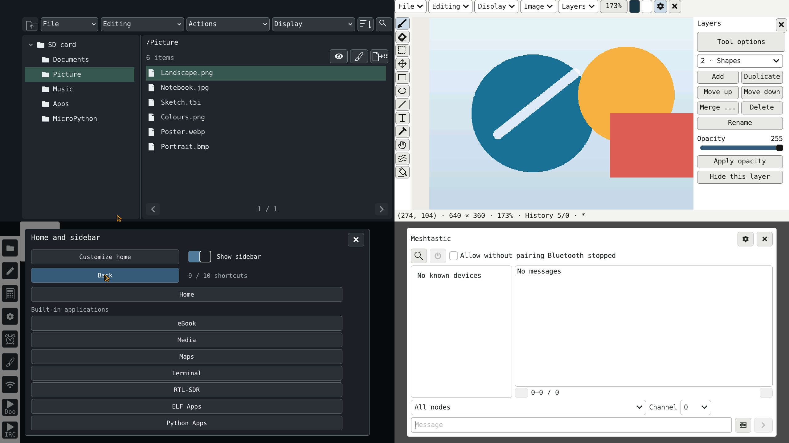

# Tab5OS

**Un environnement nomade pour M5Stack Tab5.**

[English](README.md) · [Installation](docs/INSTALL_FR.md) · [Applications](firmware/APPLICATIONS.md) · [Galerie](docs/screenshots/README.fr.md)

Tab5OS réunit écriture, dessin, lecture, médias, cartes et outils de développement sur le **M5Stack Tab5 / ESP32-P4**. Son interface s'utilise au doigt, avec un clavier USB et une souris. Documents et applications peuvent être conservés sur microSD ou support USB.

## Fonctionnalités

| Usage | Outils |
| --- | --- |
| Écrire et lire | Éditeur de texte/code, ebooks et Wikipédia hors ligne avec ses archives locales |
| Dessiner | Pinceaux, calques, sélections, formes, texte, transformations, annuler/rétablir et projets T5I ; export BMP/JPEG |
| Gérer et partager | Explorateur SD/USB, « Ouvrir avec » et partage local depuis le navigateur d'un ordinateur |
| Écouter et regarder | Lecteur multimédia et webradio |
| Explorer | Cartes en ligne/hors ligne, recherche de lieux et repères |
| Programmer | Terminal, Git, MicroPython, applications ELF et outils série |
| Se connecter | Commandes SSH distantes, SFTP, IRC et Meshtastic avec une radio externe compatible |
| Imprimer et protéger | Impression IPP, imprimantes USB prises en charge, chiffrement et coffre avec accès par PIN |
| Jouer | Doom, Maze3D, Game Boy/Color, NES, Sega 8 bits, GBA, SNES et Mega Drive |
| Personnaliser | Thèmes, langues, bandeau de raccourcis, calculatrice et réveil ; RTL-SDR avec un récepteur USB compatible |

Les **11 applications ELF prêtes à exécuter** sont dans [Applications](firmware/Tab5OS_Arduino_v0.8.53/sdcard/Applications/). Elles sont également incluses dans le paquet SD avec les applications Python, polices, langues, claviers et ressources. Les ROMs commerciales et les archives Wikipédia sont à fournir séparément.

## Télécharger et installer la 0.8.53

| Fichier | Usage |
| --- | --- |
| [Firmware OTA](downloads/Tab5OS_0.8.53_OTA.bin?raw=1) | Mettre à jour Tab5OS déjà installé |
| [Image d'installation initiale](downloads/Tab5OS_0.8.53_initial_install_16MB.bin?raw=1) | Installer depuis un ordinateur ; remplace la Flash interne |
| [Paquet microSD complet](downloads/Tab5OS_0.8.53_SD.zip?raw=1) | Applications, ressources et restauration Factory |

Suivre le [guide d'installation](docs/INSTALL_FR.md) pour choisir le bon fichier, préparer la carte ou mettre à jour une installation existante. Les [empreintes SHA-256](downloads/SHA256SUMS.txt) permettent de vérifier les téléchargements.

La [galerie](docs/screenshots/README.fr.md) présente l’interface anglaise rendue depuis le code des applications avec LVGL sur ordinateur.
