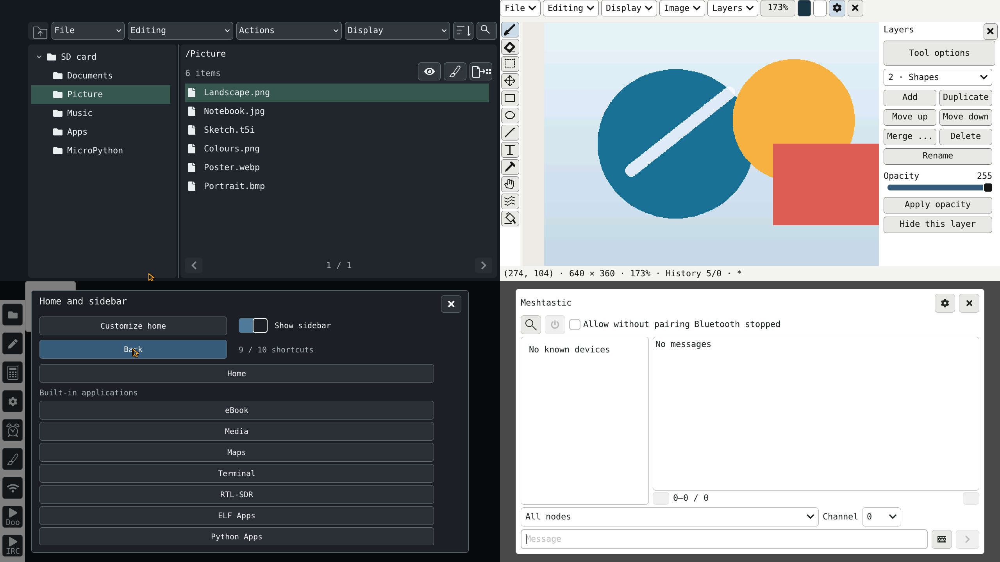

# Tab5OS

**A portable workspace for M5Stack Tab5.**

[Français](README.fr.md) · [Installation](docs/INSTALL_EN.md) · [Gallery](docs/screenshots/README.md)

Tab5OS brings writing, drawing, reading, media, maps and development tools to the **M5Stack Tab5 / ESP32-P4**. Use its graphical interface with touch, a USB keyboard and a mouse, and keep your documents and applications on microSD or USB storage.

## What you can do

| Activity | Tools |
| --- | --- |
| Write and read | Text/code editor, ebooks and offline Wikipedia with your local archives |
| Draw | Brushes, layers, selections, shapes, text, transformations, undo/redo and T5I projects; BMP/JPEG export |
| Manage and share files | SD/USB Explorer, contextual actions, “Open with” and local file sharing through a computer's browser |
| Listen and watch | Media player and web radio |
| Explore | Online/offline maps, place search and waypoints |
| Program and connect | Terminal, Git, MicroPython, native ELF applications, serial tools, remote SSH commands and SFTP |
| Communicate | IRC chat and Meshtastic with a compatible external radio |
| Print and protect documents | IPP printing, supported USB printers, file encryption and a PIN-controlled vault |
| Play | Doom, Maze3D and emulator sources for Game Boy/Color, NES, Sega 8-bit, GBA, SNES and Mega Drive |
| Customize | Themes, interface languages, app shortcuts, calculator and alarm clock; RTL-SDR with a compatible USB receiver |

Built-in tools and external ELF/Python applications share the home screen and customizable sidebar. External applications and offline content need their corresponding files on the storage card; game ROMs and commercial game data are not supplied.

## Interface previews

The cover and [gallery](docs/screenshots/README.md) show **LVGL renders on a computer**, with demonstration data. They illustrate the interface; they are not captures from a physical Tab5.

## Install or update

Follow the [installation guide](docs/INSTALL_EN.md), including preparation of the matching microSD resources.

- **Already using Tab5OS:** install the application OTA image with the built-in updater.
- **First installation:** use the merged P4 image. This replaces the internal Flash contents, including settings.
- **Existing microSD:** back up personal files and follow the resource update procedure without replacing the whole `/System` directory.

**Currently available here: the 0.8.53 sources. Precompiled firmware, a complete SD package and a Tab5OS M5Burner listing are not yet published.**
