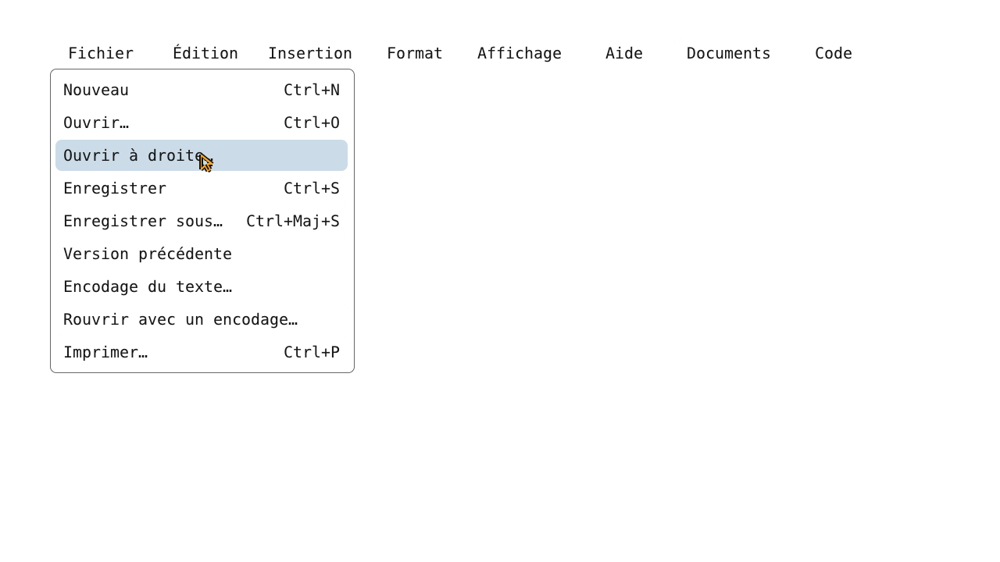

# Galerie Tab5OS — aperçus de l’interface

**Ces images sont des rendus LVGL sur ordinateur, pas des captures d’une Tab5 physique.** Les contrôleurs et composants graphiques indiqués sont ceux du projet. Les données de démonstration, périphériques et services extérieurs sont simulés aux frontières des bancs. Les barres système ne sont pas toutes présentes. Ces images illustrent l’interface ; elles ne prouvent ni performance ni fonctionnement matériel.

Les vues Dessin et le détail Éditeur proviennent des tests .52 : leurs sources de rendu ont été comparées à la .53. Les seules différences du banc Dessin concernent les tables constantes JPEG, sans modification de l’interface. Les autres vues proviennent de la .53. La provenance et les empreintes sont consignées dans [manifest.json](manifest.json).

## Explorateur — thème clair

Arbre de dossiers et actions contextuelles pour les images, avec six fichiers de démonstration.

## Explorateur — thème sombre

Même état de démonstration dans le thème sombre.

## Dessin — sélection et dégradé

Sélection libre et remplissage dégradé dans le moteur Dessin réel.

## Dessin — calques

Panneau de calques et dessin abstrait de démonstration.

## Meshtastic — messagerie

Écran initial hors connexion : aucun appareil ni message réel. Le bouton clavier est visible ; le transport Bluetooth n’est pas exécuté.

## Bandeau — choix des applications

Sélecteur des raccourcis natifs, ELF et Python. Le catalogue et le fond de page sont fournis par le banc.

## Éditeur — détail du menu

Détail du menu Fichier et du survol souris. Ce banc affiche le menu uniquement, pas la page documentaire complète.

## Couvertures

[English PNG](cover-en.png) · [Français PNG](cover-fr.png) · [SVG English](cover-en.svg) · [SVG français](cover-fr.svg)

Les couvertures sont des compositions vectorielles des captures ci-dessus. Les images embarquées sont inchangées ; seuls leur placement et leur taille d’affichage varient.
