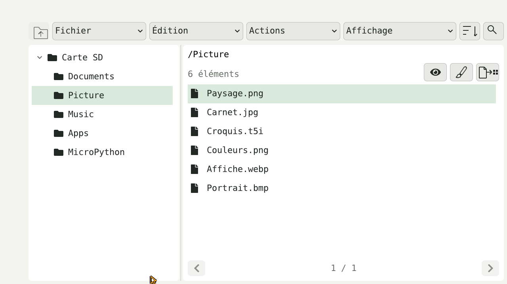
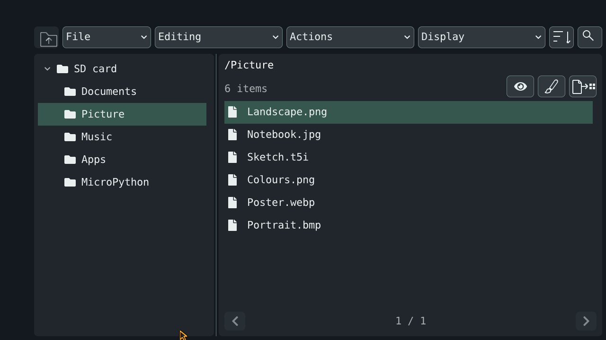
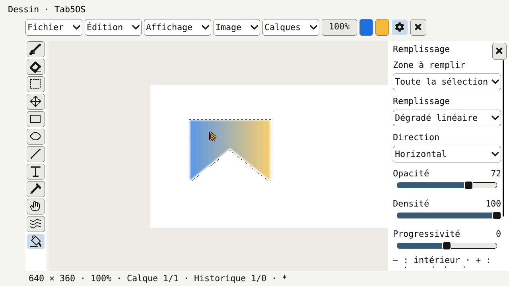
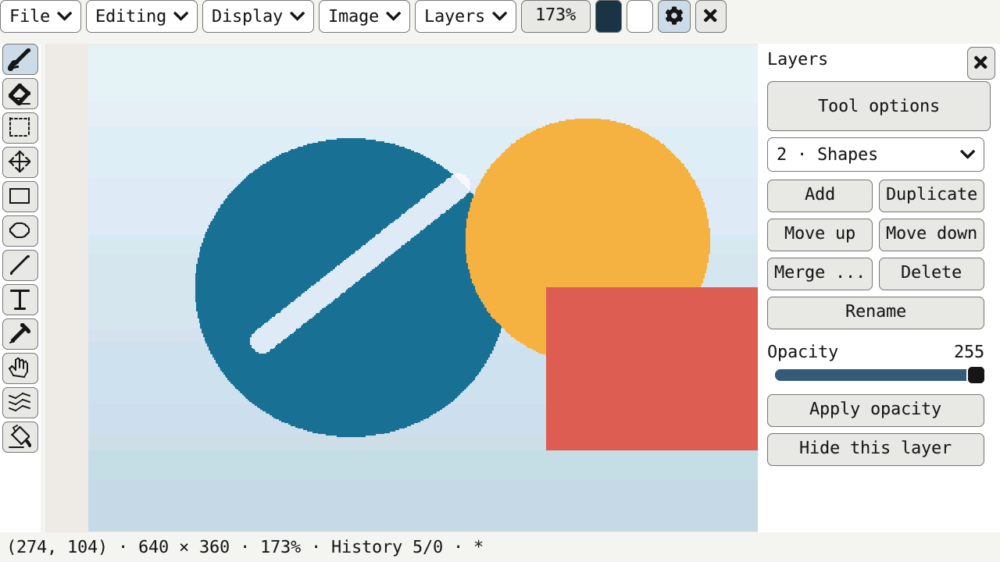
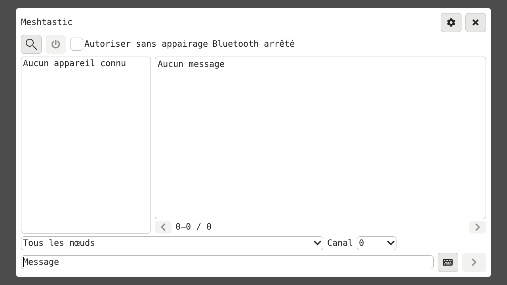
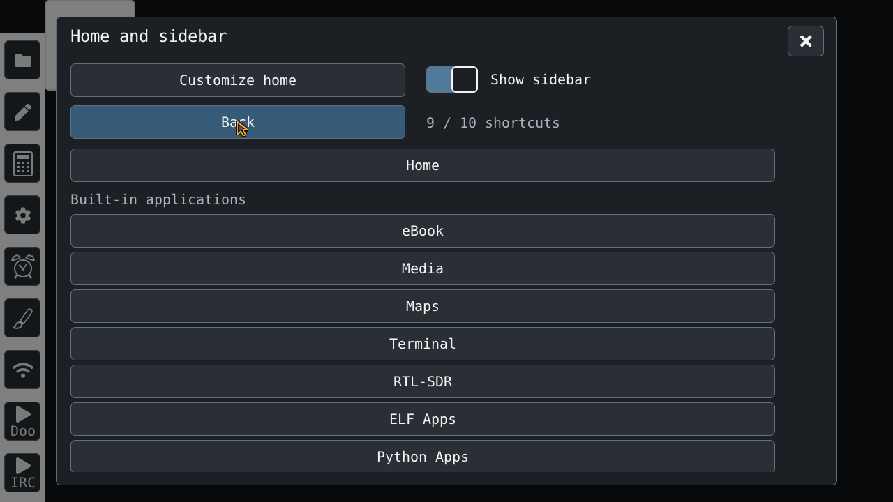
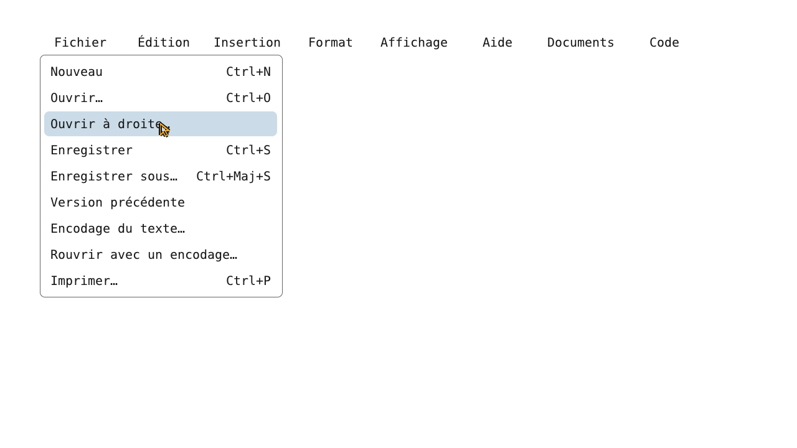

# Tab5OS gallery

Interface illustrations rendered on a computer with LVGL and demonstration data; these are not captures from a physical tablet.

## Explorer — light theme

Folder tree and image actions.

## Explorer — dark theme

The same interface with the dark theme.

## Drawing — selection and gradient

Freehand selection and gradient fill.

## Drawing — layers

Layer panel and demonstration artwork.

## Meshtastic — messaging

Messaging view, shown offline.

## Sidebar — application selection

Native, ELF and Python shortcut selection.

## Editor — File menu

File menu and pointer hover.

